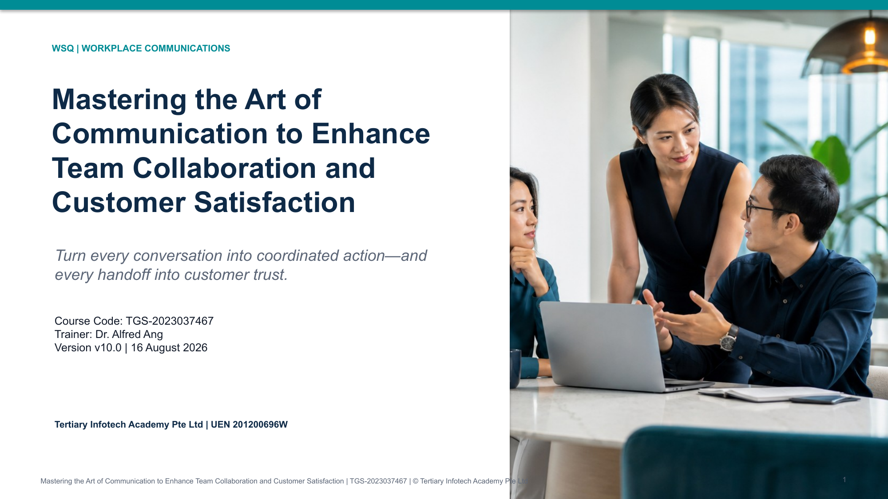

# Mastering the Art of Communication to Enhance Team Collaboration and Customer Satisfaction

WSQ Course Code: **TGS-2023037467**  
Release: **v10.0 — 16 August 2026**  
Training Provider: **Tertiary Infotech Academy Pte Ltd**

This release preserves the three official domains from the legacy v9 deck and rebuilds the course as a visual, scenario-led communication masterclass. Detailed procedures, role cards, questions, evidence requirements and acceptance criteria are in the Learner Guide and the individual `activities/` folders—not on the presentation slides.

## Courseware

- [Trainer Slides (PPTX)](courseware/WSQ%20-%20Master%20Trainer%20Slides%20-%20Mastering%20the%20Art%20of%20Communication%20to%20Enhance%20Team%20Collaboration%20and%20Customer%20Satisfaction%20-%20v10.0.pptx)
- [Trainer Slides (PDF)](courseware/WSQ%20-%20Master%20Trainer%20Slides%20-%20Mastering%20the%20Art%20of%20Communication%20to%20Enhance%20Team%20Collaboration%20and%20Customer%20Satisfaction%20-%20v10.0.pdf)
- [Learner Guide (DOCX)](courseware/LG-Mastering%20the%20Art%20of%20Communication%20to%20Enhance%20Team%20Collaboration%20and%20Customer%20Satisfaction.docx)
- [Learner Guide (PDF)](courseware/LG-Mastering%20the%20Art%20of%20Communication%20to%20Enhance%20Team%20Collaboration%20and%20Customer%20Satisfaction.pdf)
- [Lesson Plan (DOCX)](courseware/LP-Mastering%20the%20Art%20of%20Communication%20to%20Enhance%20Team%20Collaboration%20and%20Customer%20Satisfaction.docx)
- [Lesson Plan (PDF)](courseware/LP-Mastering%20the%20Art%20of%20Communication%20to%20Enhance%20Team%20Collaboration%20and%20Customer%20Satisfaction.pdf)
- [Eight self-contained activities](activities/README.md)
- [Class collaboration board (Padlet)](https://alfredang.github.io/padlet/) — learners post activity outputs and takeaways for peer review
- [Source coverage](SOURCE-COVERAGE-v10.0.md)
- [QA and alignment report](QA-ALIGNMENT-v10.0.md)

The assessment instruments and answer keys are intentionally excluded from this public repository. No practice exam is included.

## Official links

- [Course page](https://www.tertiarycourses.com.sg/wsq-mastering-the-art-of-communication-to-enhance-team-collaboration-and-customer-satisfaction.html)
- [Learner portal](https://lms.tertiaryinfotech.com/)

